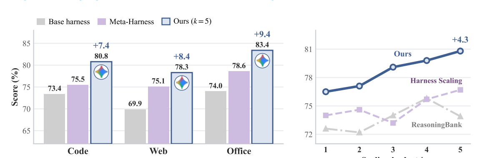
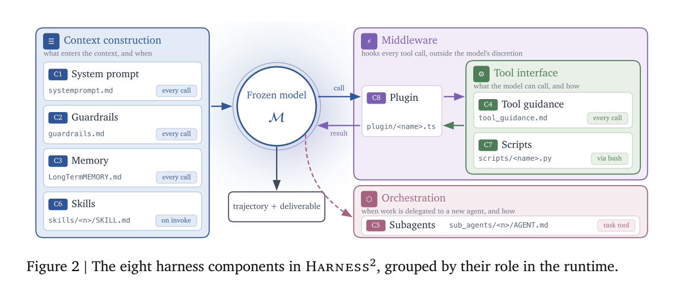
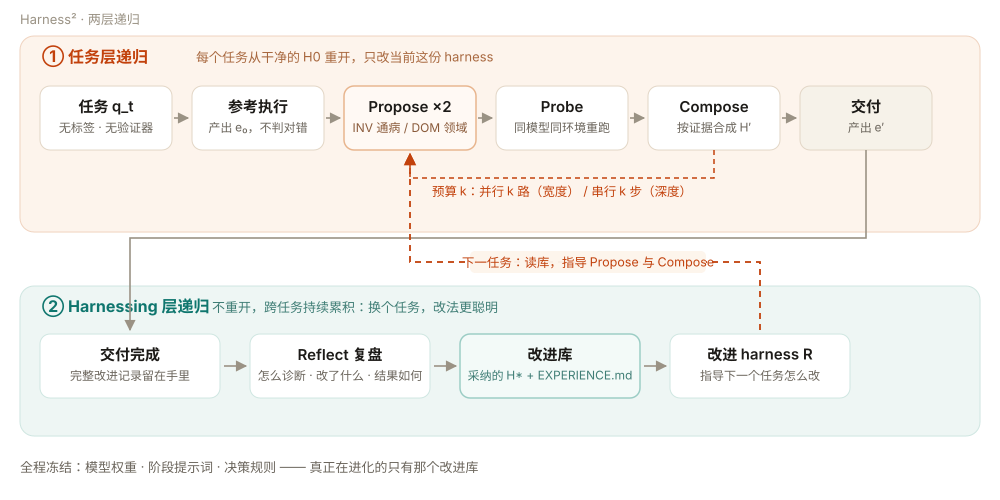
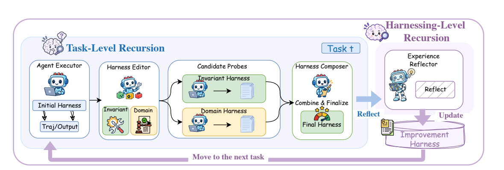
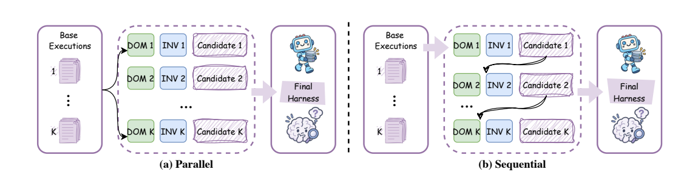
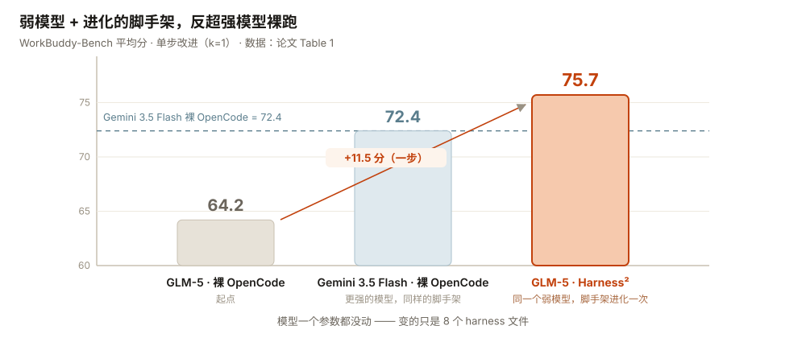
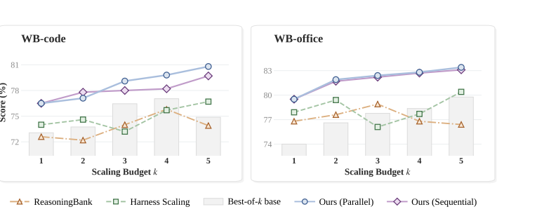
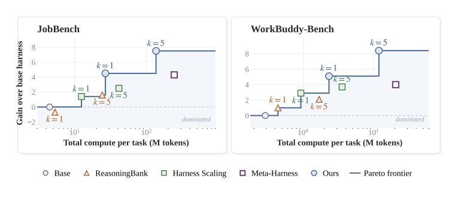
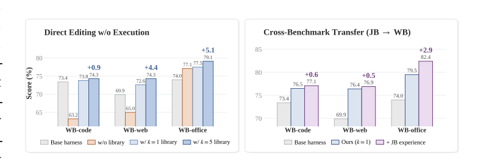
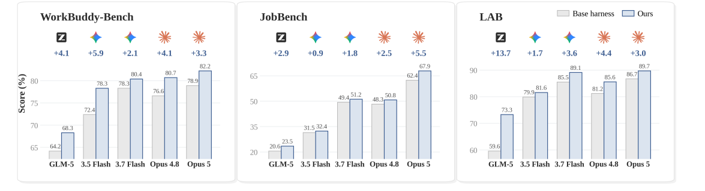

# Harness²：让 Agent 自己进化自己的「脚手架」

> 论文：*Harness²: Recursive Agent Harnessing for an Open World*（arXiv 2610.14224，2026-10）
> 作者：Ruiyao Xu（西北大学）、Yanfei Chen 等，Google Cloud AI Research
> 代码：github.com/google-research/harness2 · 主页：harness2.github.io

> 口播提示：开场 30 秒内抛出钩子——「同一个模型，换个脚手架，分数差 11 分」。

## 开场：模型很强，为什么 Agent 还是翻车？

同一个 Gemini 3.5 Flash，在 WorkBuddy-Bench 的 Code 域上，裸 harness 只有 73.4 分；换上这篇论文自动进化出的 harness，能到 83.4。差了整整 10 分——**模型一个参数都没动**。

这 10 分的差距全在 harness 上：模型外围那套提示词、记忆、技能、工具说明和编排逻辑。问题在于，harness 至今靠工程师手写手调，而 agent 要处理的任务越来越杂——写代码、做 Office 报表、法律文书，没人能提前为所有场景写好脚手架。

所以这篇论文问了一个很直接的问题：**能不能让系统自己改进 harness，并且在改进的同时，学会「怎么改进」？**

> 口播提示：强调「模型不动」这个前提，这是全文所有结论的地基。

## Harness 到底是什么：8 个可以改的零件

论文里的 harness 不是玄学，是 **8 个挂在运行时的文件**，每个都可以被单独编辑：

| 零件 | 文件 | 什么时候生效 |
|---|---|---|
| C1 系统提示 | systemprompt.md | 每次调用 |
| C2 护栏 | guardrails.md | 每次调用 |
| C3 记忆 | LongTermMEMORY.md | 每次调用 |
| C4 工具指引 | tool_guidance.md | 每次调用 |
| C5 子代理 | sub_agents/n/AGENT.md | 委派任务时 |
| C6 技能 | skills/n/SKILL.md | 按需加载 |
| C7 脚本 | scripts/name.py | 通过 bash 调 |
| C8 插件 | plugin/name.ts | 钩在工具循环里 |

按作用分三组：**上下文构造**（C1–C3，决定模型看到什么）、**中间件**（C4、C8，管每次工具调用）、**编排**（C5–C7，管工作怎么被拆出去执行）。

「改 harness」在这里就非常具体：**改这些文件的内容**。模型冻结，改的全是外围。

> 口播提示：这页可以快讲，但要留一句「后面所有魔法都发生在改这 8 个文件上」。

## 难点：开放世界里没有标准答案

让系统自动改 harness 并不新鲜，难的是「开放世界」这个设定，它卡住两件事：

1. **没有验证器。** 真实任务来了没有标准答案、没有单元测试。以前的自动改进方法，要么在固定的训练集上离线搜（跑完再上线），要么假设有 ground truth 或让模型互相当裁判。没有对错信号，怎么判断一次修改是变好了还是变坏了？
2. **这次改好 ≠ 下次会改。** 为某个任务量身定制的 harness，换个任务就失效；直接把上一任务的定制版继承下去，任务分布一变，递归改进反而变成噪声累积。

但作者注意到一件事：**改进过程本身留下了高价值经验**——弱点是怎么被诊断出来的、试了哪些改动、改动后行为有什么变化。这些经验比改出来的那个 harness 更通用。

于是有了全文的核心主张：改进机制本身也应该被递归地改进。

> 口播提示：这里是全文的「为什么」，讲慢一点。听众记住「没答案 + 不迁移」这两个痛点即可。

## 核心设计：两层递归

Harness² 的答案是把递归拆成两层，咬合在一起：

- **任务层递归（Task-level）**：针对当前任务，把执行 harness 改出一版更好的。核心是一步「对比式改进」：Propose → Probe → Compose，可以按预算并行或串行放大。
- **Harnessing 层递归（Harnessing-level）**：每个任务结束后，把「这次是怎么改的」沉淀成一个**改进 harness**（ improver），让下一个任务的改法更聪明。

一句话版本：**执行 harness 是被改进的对象，改进 harness 是执行改进的机制；前者每个任务重开，后者跨任务持续积累。**

注意两个细节：任务层递归期间 improver 冻结不动；improver 里存的是一个「harness 改进库」——保存被采纳的 harness 和它们的改进教训，供后续任务复用和改编，而不是无脑继承。

> 口播提示：用「工人 vs 工头」或「代码 vs 编译器」类比讲这两层，比念定义有效。

## 一步改进：Propose–Probe–Compose

这是全文技术上最核心的一步，全靠「行为对比」代替标准答案：

**Propose（提两个候选）**。先跑一遍当前 harness，得到参考执行——注意，它只揭示「harness 是怎么行为的」，不判断对错。然后并行提两个编辑方向的候选：
- **不变式候选（Invariant）**：针对跨领域都会复发的 agent 通病——规划、工具使用、上下文管理、委派。
- **领域候选（Domain）**：针对当前领域的知识、流程和约束。

**Probe（同一任务上实测）**。每个候选 harness 在**相同模型、相同环境**下重跑同一个任务，把它的轨迹和产出跟参考执行对比，得到「行为对比」：目标缺陷有没有缓解？行为没变？还是引入了退化？作者明确说：这只是**证据，不是正确性判定**——执行有随机性，模型裁判有共同偏见。

**Compose（只采纳有证据支撑的改动）**。把参考执行、候选、每个候选相对当前 harness 的 diff、全部执行证据一起交给 Composer。它可以合并改动、修订冲突、整只采纳、也可以保持现状——**每条决策都必须挂在一个具体观察上，而不是「估计分数会涨」**。合成出的新 harness 再执行一次，决策和证据全部记档。

> 口播提示：这页是全文技术含量最高的一页，值得多停留。强调「对比的是行为，不是分数」。

## 放大探索：并行递归 vs 串行递归

一步改进之上，用预算 k 控制探索规模，两种玩法：

**并行递归**：跑 k 份参考执行，独立提出 k 个不变式 + k 个领域候选，然后开 k 个互相独立的 Composer 会话，各自看全部证据池、各合成一个后继 harness。这是「宽度」探索——k 控制的是这一代种群的大小，不是深度。

**串行递归**：链式跑 k 步对比改进，每一步都继承上一步的 harness 和全部执行历史，后面的步可以保留、修订、甚至纠正前面的改动。这是「深度」探索。

k > 1 时最后加一个**盲选**：一个 selector 只看匿名化的产出和任务要求，选出最好的——它不知道产出来自哪个 harness，也不合成新内容。k = 1 时两种形式都退化为基础对比步，不需要选择。

> 口播提示：一句话记忆：并行=开脑洞开一堆，串行=一根筋改到底。实验部分会回答哪个更划算。

## 第二层递归：把「怎么改」变成可复用的资产

任务交付后，流水线复盘完整的改进记录——参考执行、候选、探针结果、Compose 的每条决策——提炼成经验，写回 improver 的**改进库**。库里存的是：

- 被采纳的 harness **本体**（可执行组件原样保留，不摘要成散文）；
- 一份 EXPERIENCE.md：为什么选它、解决了什么反复出现的弱点。

下一个任务照常从干净的初始 harness H0 出发，但 Propose 和 Compose 时能查库：老组件可以**被挑选、被改编**复用，经验也会影响探针设计和合成判断。模型权重、阶段提示词、决策规则全程冻结，**进化的只有这个库**。

> 口播提示：强调「每个任务从干净 H0 开始」——这就是它和「直接继承上个任务 harness」方法的本质区别。

## 实验设置：三个职场基准 × 四种配置

- **WorkBuddy-Bench**：办公类交付物，Code / Web / Office 三个域。
- **JobBench**：65 个真实职业任务（取 34 个测试），长执行、按 rubric 打分。
- **LAB**（Harvey 法律 Agent 基准）：1251 个法律任务，报告 Partial（按条通过率）。

执行者：Gemini 3.5 Flash 和 GLM-5（均冻结）；初始 harness：OpenCode 和 Codex 两个现成 coding agent；**改 harness 的编辑器是 Claude Opus 4.8**。主表是单步改进（k=1），+Recursion 是并行递归 k=5。改进库从空开始，每个基准跑 3 条乱序任务流取平均。

对手（baseline）覆盖三种流派：
- **Base harness**：不改。
- **ReasoningBank**：不改 harness，只把历史策略检索回上下文。
- **Meta-Harness**：离线在训练集上搜出最优 harness 再部署。
- **Harness Scaling**：每个任务现场花推理预算改 harness，但不跨任务带状态。

> 口播提示：报配置时快一点，听众只需要记住「没答案、库从零开始、编辑器还是另一个模型」。

## 主结果：一步就涨，弱模型涨得更多

**单步（k=1）就全面见效**，四个配置 × 三个基准无一例外：

| 配置 | 基准 | 基线 → Harness² | 提升 |
|---|---|---|---|
| GLM-5 + OpenCode | WorkBuddy-Bench | 64.2 → 75.7 | **+11.5** |
| GLM-5 + OpenCode | LAB (Partial) | 59.6 → 71.4 | **+11.8** |
| Gemini + OpenCode | JobBench | 31.5 → 36.0 | +4.5 |
| Gemini + OpenCode | WorkBuddy-Bench | 72.4 → 77.5 | +5.1 |
| GLM-5 + Codex | WorkBuddy-Bench | 64.4 → 75.3 | +10.9 |

三个值得停一停的点：

1. **弱模型受益最大。** GLM-5 + OpenCode 被 Harness² 抬到 75.7，超过了裸跑的 Gemini（72.4）——**弱模型配好脚手架，反超强模型裸跑**。
2. **对手不是平的。** ReasoningBank 在编程任务上最多掉 6.6 分；Harness Scaling 在 12 个「基准×配置」组合里 7 个低于基线。
3. **步数反而更少。** Harness² 在 WorkBuddy-Bench 平均 21.9 步 vs 基线 25.4 步——分数涨了，执行还更短。

k=5 并行递归再叠加 +2.9～+3.9（WB）、+3.0～+4.2（JobBench）、+2.6～+6.7（LAB）。

> 口播提示：「弱模型反超强模型」是这页的金句，值得重复一遍。

## 预算加得越多，涨得越稳

两种递归在 k=1→5 上都单调上升：并行递归在 Code 域 76.5 → 80.8，Office 域 79.5 → 83.4；对照的 ReasoningBank 和 Harness Scaling 则波动、甚至在 k=2→3 上回退。特别值得注意的是：**Harness² 在 k=2 时就已经超过所有基线在 k=5 的成绩**。

把全部 token（执行 + 改进）算进去看性价比：两个 Harness² 配置都落在**经验 Pareto 前沿**上。Gemini + OpenCode 从 k=1 到 k=5，JobBench 领先基线的幅度从 +4.5 扩大到 +7.5，WB 从 +5.1 到 +8.4；而 Meta-Harness 花了比 Harness² k=5 更多的算力，分数反而更低。

> 口播提示：这页回答「是不是靠烧钱」——答案是多花的钱买到了更多分，且比对手的花法划算。

## 消融：三个零件各值几分

把 Harness² 拆开看（WB 平均 / JobBench，Gemini + OpenCode，k=1）：

| 配置 | WorkBuddy | JobBench | 掉分 |
|---|---|---|---|
| 完整 Harness² | 77.5 | 36.0 | — |
| 去掉改进库 | 74.4 | 34.2 | −3.1 / −1.8 |
| 去掉分工（用两个通用编辑器） | 74.6 | 32.3 | −2.9 / −3.7 |
| 去掉合成（只二选一） | 75.9 | 34.1 | −1.6 / −1.9 |

三个组件都有贡献，其中**「编辑器分 invariant / domain 两路」和「经验库」最贵**。去掉合成（Composer）掉分最少，但也说明「两个候选二选一」不如「把两边的证据合成一版」。

> 口播提示：可以顺势带一句对应附录里的组件消融：skills、scripts、prompt 各贡献几分，去掉哪个都仍比 base 强。

## 经验库真的在被复用吗？三组证据

**第一组：没有执行证据、瞎改会倒退。** 让 improver 不看参考执行、候选探针和改进库，直接对着 base harness 改：Code 从 73.4 掉到 63.2，Web 从 69.9 掉到 65.0。**有 k=1 的库就能恢复基线水平**——说明涨分来自「对比 + 证据」这套流程，不是「多改几刀」。

**第二组：库越大，下一步改得越猛。** k=5 积累的库让单步改进在 Code / Web / Office 再涨 +0.9 / +4.4 / +5.1，而且**不需要额外探针**。跨基准迁移也成立：JobBench 攒的库搬到 WorkBuddy-Bench，单步 +0.6 / +0.5 / +2.9。回溯检验（把每个任务自己的记录从库里剔除重跑）仍有 +1.9 / +1.7——复用是真实的，不是背题。

**第三组：编辑器不需要比执行者强。** 让 5 个模型（GLM-5 到 Claude Opus 5）自己改自己（k=2），全部在全部基准上涨分：Opus 5 +3.3 / +5.5 / +3.0，GLM-5 在 LAB 上 +13.7。**改进 harness 不依赖「老师模型」。**

> 口播提示：这页是回应观众最可能的质疑：「是不是靠一个更强的模型在偷偷兜底？」三组证据各给一句话。

## 案例：一个任务从 43.1 分到 77.8 分

JobBench 上的真实例子（Gemini + OpenCode）。基线跑 43.1 分，看轨迹发现问题**不是不会，而是没做**：数据从没跨文件对过账，文件写完从没打开复查过。

两路编辑各出一刀：
- **不变式护栏**：强制先清点所有输入、数字溯源到原始文件、写完的产出必须用校验脚本重开检查；
- **领域技能**：提供日程 / 场地 / 人力 / 预算四类文件的对账方法，外加数字格式的工具指引。

Composer 把四个改动**全部保留**。重跑：成功交叉核对数字、补回备忘录缺失的章节，77.8 分。

> 口播提示：这个案例完美演示了 Propose 两路分工——通病一刀，领域一刀——和「证据驱动合成」的落地样子。

## 边界与没解决的事

作者自己列的局限，讲视频时别藏：

- **没有真验证器**，一切依赖行为对比和模型判断，对执行随机性和模型的共同偏见敏感；不保证正确，也不保证迁移。
- **递归形式和预算 k 是人为预设的**，理想状态应该按任务难度和经验相关性自适应分配探索，到没新证据时停止。
- 选择环节（k>1 的盲选）只是「采纳」而非「验证最优」；失败案例分析（附录 E.6）显示选错候选、改得太保守都会发生。

> 口播提示：诚实讲局限反而加分——这套方法证明的是「平均更好」，不是「每次更好」。

## 收尾：为什么这篇值得讲

1. 它把「自动改进 agent」从玄学落到了**可编辑的文件**上：8 个组件、每处改动有 diff、每条决策挂证据。
2. 它回答了无监督改进的经典死结：不比分数，比**行为**。
3. 它证明改进经验本身是资产：任务层探索越多，improver 越强，跨基准都能迁移。
4. 工程上完全即插即用：套在 OpenCode、Codex 这种现成 agent 上，模型和编辑器都不用动。

对做 agent 的人一句话带走：**别只优化你那套 prompt，把「你怎么优化 prompt」这件事也变成可以被复盘、被沉淀、被复用的流程。**

> 口播提示：结尾回到开场数字呼应（73.4 → 83.4），一句「模型没变，变的是脚手架」收束。
